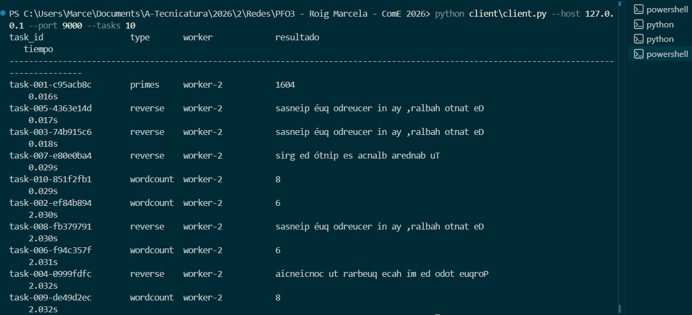
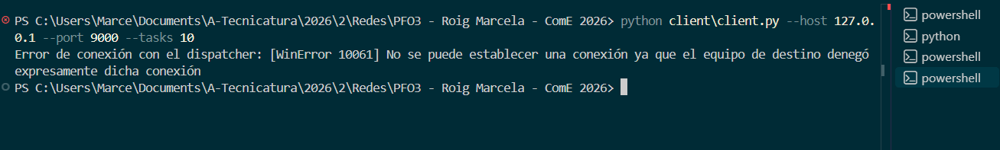

# Sistema distribuido de tareas sobre sockets

## Descripción

En esta PFO dos clientes envían tareas a un **dispatcher**
TCP. El dispatcher distribuye las tareas entre workers mediante round-robin.
Cada worker es un proceso independiente y usa un `ThreadPoolExecutor` para
procesar varias tareas en paralelo.

El protocolo usa mensajes JSON en UTF-8 con un prefijo de longitud de 4 bytes
en formato big-endian. Cada respuesta conserva el `task_id`, por lo que las
respuestas pueden llegar en un orden diferente al de envío.

Se soportan estas tareas:

- `primes`: cuenta los números primos hasta `N`.
- `reverse`: devuelve un texto invertido.
- `wordcount`: cuenta las palabras separadas por espacios en blanco.

## Relación con el diagrama

El archivo [docs/diagrama.md](docs/diagrama.md) queda reservado para el
diagrama de la práctica. Allí aparecen Nginx, RabbitMQ, PostgreSQL y
S3 como componentes de una arquitectura más amplia, pero **no están
implementados en este código**. La implementación actual contiene únicamente
clientes, dispatcher, workers y el protocolo TCP compartido.


## Ejecución 

En cuatro terminales ubicadas en la raíz del proyecto.

### 1. Worker 1

```bash
python server/worker.py --host 127.0.0.1 --port 9101 --name worker-1 --threads 4
```

### 2. Worker 2

```bash
python server/worker.py --host 127.0.0.1 --port 9102 --name worker-2 --threads 4
```

### 3. Dispatcher

```bash
python server/dispatcher.py --host 127.0.0.1 --port 9000 \
  --workers 127.0.0.1:9101 127.0.0.1:9102
```

### 4. Cliente

```bash
python client/client.py --host 127.0.0.1 --port 9000 --tasks 10
```

## Evidencias de ejecución

### Ejecución normal


Con dos workers activos, las 10 tareas se reparten de forma equitativa mediante round-robin (5 por worker) y las respuestas llegan en distinto orden al de envío, identificadas por task_id.

### Ejecución con un hilo


Con el worker-1 detenido, el cliente envió 10 tareas y las 10 se completaron correctamente por el worker-2. Las tareas que tardaron cerca de 2 s corresponden a los intentos fallidos contra el worker caído antes de que el dispatcher reintentara con el siguiente worker disponible.

### Dispatcher cerrado


Al detener el dispatcher, el cliente detecta el rechazo de la conexión (WinError 10061) y lo informa con un mensaje claro, sin interrumpirse de forma abrupta.
